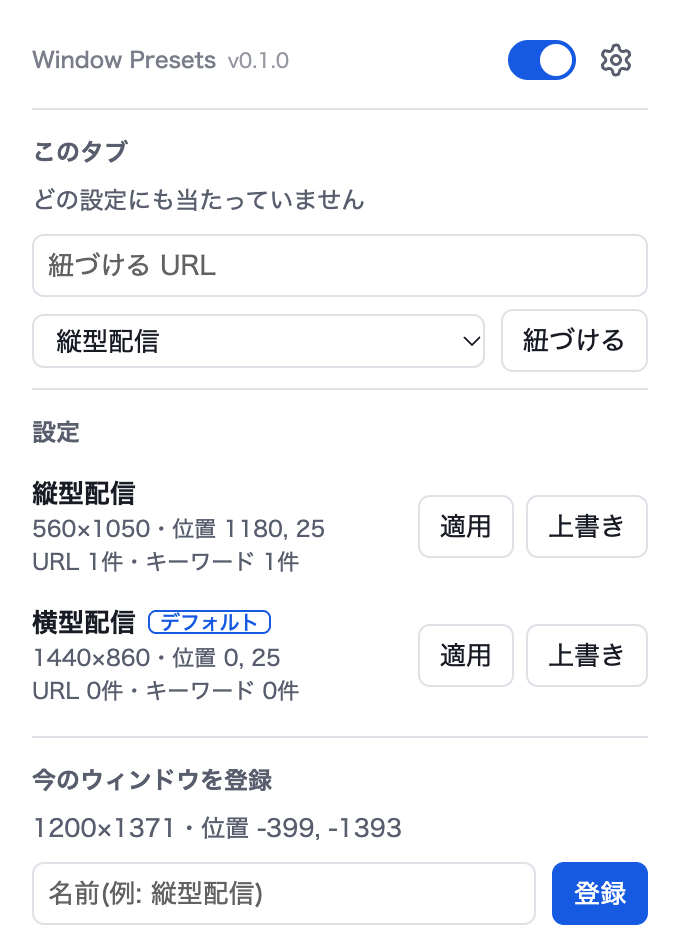

# Window Presets

登録した URL を開いたら、Chrome のウィンドウの位置とサイズを登録しておいた値に自動で合わせる拡張機能です。
YouTube の縦型配信を開いたら縦長、それ以外の配信なら横長のウィンドウにする、といった使い方を想定しています。



## 使い方

1. ウィンドウを合わせたい位置とサイズにしてから、ツールバーのポップアップで名前を付けて「登録」する
2. 対象のページを開いた状態でポップアップを開き、「このタブ」の URL を確かめて「紐づける」
3. 以後、その URL がアクティブなタブで開かれると、ウィンドウが登録した位置とサイズに変わる

- 1つの設定に URL をいくつでも紐づけられます。URL の編集・削除は設定画面で行います。
- 「適用」で今のウィンドウにすぐ当てられ、「上書き」で今のウィンドウの位置とサイズに登録し直せます。
- 位置とサイズを当てるのは、そのウィンドウで設定に当たるページへ来たときの1回だけです。
  同じ設定に当たるページの中を移動している間は、手で動かしたウィンドウを戻しません。
  当たらないページを挟むと、次に当たったときにまた当てます。
- 最大化・フルスクリーンのウィンドウは、通常の状態に戻してから当てます。

## URL の書き方

| 例 | 当たるもの |
| --- | --- |
| `https://www.youtube.com/@channel/live` | そのページ(`?si=…` などが付いても当たる。`…/livestream` には当たらない) |
| `https://www.youtube.com/@*/live` | `*` は任意の文字列 |
| `www.youtube.com/@channel/live` | スキームを省くと http と https の両方 |

## YouTube は配信中のページだけ

YouTube では**配信中のページだけ**を対象にします。通常の動画・ショート・配信のアーカイブには反応しません
(URL が当たっていても何もしません)。配信かどうかは、YouTube のページに入れたスクリプトがプレイヤーから読み取ります。

## タイトルのキーワード

設定画面で、設定ごとに「YouTube の配信のタイトルに含まれるキーワード」を登録できます(例: `#縦型配信`)。
チャンネルページのサムネイルから入って URL が `/watch?v=…` になった配信でも、タイトルで拾えます。

- 部分一致で、大文字小文字と全角半角の違いは無視します

## 優先度(並び順)とデフォルト

複数の設定に当たるときは、**設定画面で上に並んでいる設定**を使います。
並び順はカード左上のつまみ(⋮⋮)をドラッグして入れ替えます。

カードの「デフォルトを有効」をオンにした設定は、**どの設定にも当たらなかった YouTube の配信**で使います。
デフォルトにできるのは1つだけで、並び順に関係なく、URL やキーワードで当たった設定の方が先です。

縦型配信だけ縦長に、残りの配信は横長にする例:

| 設定 | URL | タイトルのキーワード | デフォルトを有効 |
| --- | --- | --- | --- |
| 縦型配信 | 縦型で配信しているチャンネルの `…/@channel/live`(なくてもよい) | `#縦型配信` | オフ |
| 横型配信 | なし | なし | オン |

YouTube では、配信かどうかとタイトルが分かってから当てるので、移った直後に一度横長にしてから縦長へ当て直すことはありません。

## エクスポート・インポート

設定画面の右上から、すべての設定を JSON ファイルに書き出したり、読み込んだりできます。

- **エクスポート**: 選んだフォルダの中の決まったファイルに上書きします。フォルダは初回に選び、以後は覚えています。
  ファイル名は欄で変えられます(初期値はブラウザの種類付きの `window-presets-chrome.json` など)。
  フォルダを選べないブラウザ(Brave など)では、同じ名前でダウンロードします
- **インポート**: ファイルの内容で**今の設定をすべて置き換えます**(並び順が優先度なので、足し合わせると並びが崩れるため)

## インストール

1. `chrome://extensions` で「デベロッパー モード」をオンにする
2. 「パッケージ化されていない拡張機能を読み込む」でこのディレクトリを選ぶ

## 権限

- `tabs` — タブの URL を読むため
- `storage` — 設定を保存するため(`chrome.storage.sync`)
- `www.youtube.com` のページへのスクリプト — 配信中かどうかと配信のタイトルをプレイヤーから読むため。ページの表示は変えません

ウィンドウの操作(`chrome.windows`)に権限は要りません。

## テスト

```sh
node --test test/
```

## ライセンス

MIT
